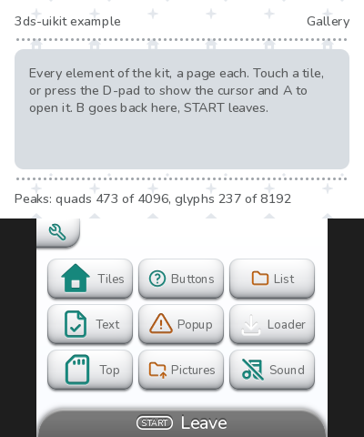
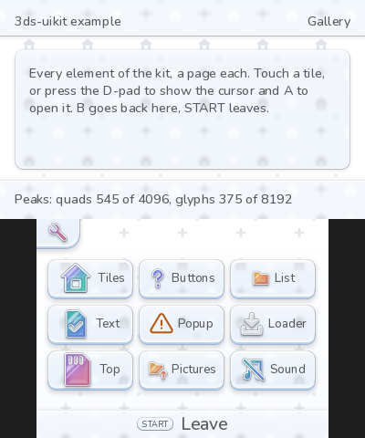
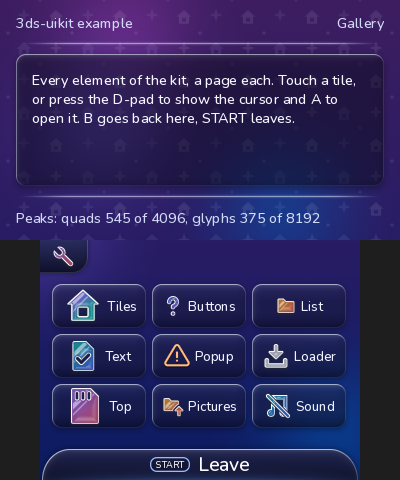
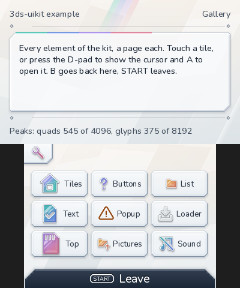
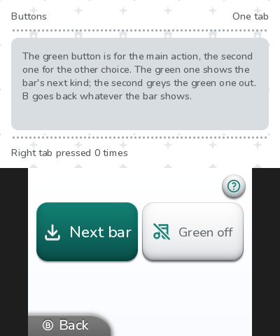
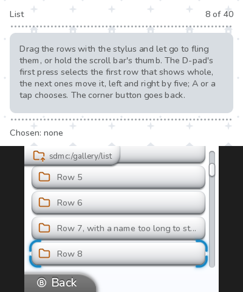
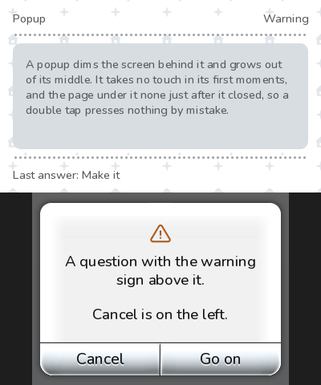
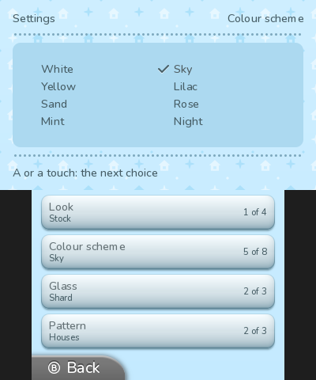

# 3ds-uikit

An interface kit for Nintendo 3DS homebrew. It draws a program's two screens from ready-made elements (buttons, tiles, lists, popups, bars, a loader, text that fits) in four looks and eight colour schemes, with interface sounds and menu music. A C library on top of citro2d, citro3d and libctru.

| Stock | Frost | Nachtglas | Prisma |
| --- | --- | --- | --- |
|  |  |  |  |

| Buttons | Lists | Popups | Colour schemes |
| --- | --- | --- | --- |
|  |  |  |  |

The pictures show the kit's [example](example/README.md), drawn by the kit's own host renderer. On the console the text is set in the system font.

## What you get

- **Elements** for both screens: tiles, buttons, button bars and tabs, rows and scrolling lists, choices, popups, a loader, a progress bar, cards, and text that wraps or is cut to fit. See [docs/elements.md](docs/elements.md).
- **Four looks**: Stock (the look of the console's own menus, rebuilt from measurements), Frost, Nachtglas and Prisma, each in eight colour schemes. See [docs/looks.md](docs/looks.md).
- **Input** that feels right: touches that press, drag into a scroll or cancel by sliding off, lists that fling, a guard against double taps on popups. See [docs/input.md](docs/input.md).
- **Sound**: seven interface sounds, looping menu music and a working loop, played through `ndsp`. See [docs/sound.md](docs/sound.md).
- **Stereoscopic 3D**: every frame is drawn for both eyes when the 3D slider is up.
- **Your own images in each look's style**, through one hook of the art generator. See [docs/part.md](docs/part.md).

## The shape of a program

```c
#include <3ds.h>
#include "ui.h"

int main(void)
{
    ui_init();                          /* brings up gfx, citro3d and citro2d itself */
    while (aptMainLoop()) {
        hidScanInput();
        if (hidKeysDown() & KEY_START)
            break;
        ui_begin(1.0f);                 /* 0 to 1: how far a screen that just opened has come in */
        do {
            ui_top();
            /* draw the top screen's elements */
            ui_bottom();
            /* draw the bottom screen's elements */
        } while (ui_next_eye());        /* a second pass for the right eye */
        ui_end();
    }
    ui_exit();
    return 0;
}
```

[docs/example.md](docs/example.md) walks through a real program: the example in [`example/`](example/README.md), a gallery with a page for each group of elements.

## Use it in your program

- **As a git submodule**: `git submodule add https://github.com/albxncom/3ds-uikit 3ds-uikit`. Your Makefile compiles the kit's sources, its art and its sounds beside your own files; the example's Makefile shows how.
- **As an installed library**: in the devkitPro image, `make install` puts the kit into devkitPro's 3DS portlibs folder. Compile with `-I$(PORTLIBS)/include/3ds-uikit` and link `-l3ds-uikit -lcitro2d -lcitro3d -lz -lctru -lm`.

Both ways in detail: [docs/repository.md](docs/repository.md#taking-the-kit).

## Build and test

| Command | Where | What it does |
| --- | --- | --- |
| `make test` | on the host | the unit tests in a plain and a sanitizer build, and the Python checks; needs make, a C compiler, zlib and Python 3 with Pillow |
| `make example` | in the devkitPro image | builds `example/build/3ds-uikit-example.3dsx` |
| `make lib`, `make install` | in the devkitPro image | the static library, and its install into the portlibs folder |
| `make docs-pictures` | on the host | draws the pictures of the docs again |

The image is named in `tools/build/image.sh`. More in [docs/repository.md](docs/repository.md#build-and-test).

## Layout

| Folder | What it holds |
| --- | --- |
| `include/` | the kit's headers |
| `source/` | its C sources |
| `art/` | the art generator: every image of the kit is drawn at build time (Python) |
| `icons/`, `sound/` | the icons the generator strokes; the interface sounds and the music |
| `example/` | the example program |
| `docs/` | the documentation, start at [docs/README.md](docs/README.md) |
| `host/`, `tools/` | the host tests; the build scripts and the host renderer |
| `pacman/` | the description of the kit's package for devkitPro's pacman |

## Status

Version 0.1.0. The kit was cut out of [3DStockTheme](https://github.com/albxncom/3dstocktheme), a theme installer for the 3DS, which is its first user; so far it has run on one console model, a New 3DS XL. The headers are plain C without `extern "C"` guards, and some global names carry no prefix yet: see [the known limits](docs/repository.md#known-limits).

## Credits and licence

The kit's own files are under the zlib licence, see [`LICENSE`](LICENSE). The icons are [Tabler Icons](https://github.com/tabler/tabler-icons) (MIT), the interface sounds are by [Kenney](https://www.kenney.nl) (CC0), the music is by Peachtea and MintoDog (CC0), and the host renderer's font is Nunito (SIL Open Font License). Every source with its version and licence is in [docs/credits.md](docs/credits.md).

The kit was built with [Claude Code](https://claude.com/product/claude-code), Anthropic's coding agent.

This project is not affiliated with Nintendo. The Stock look is rebuilt from measurements of the console's screens; nothing of Nintendo's is in the repository.
