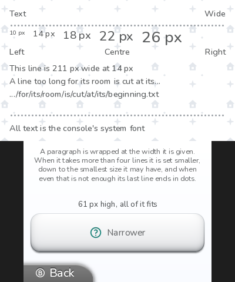
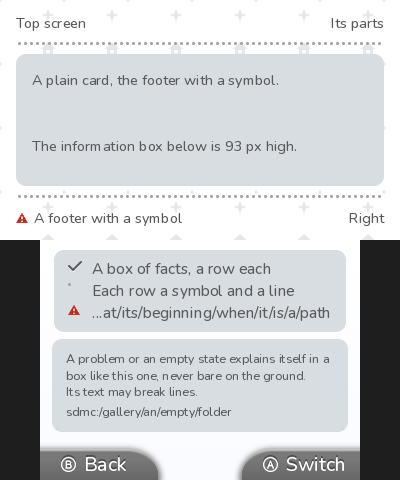
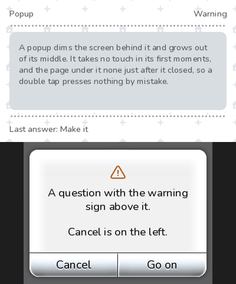
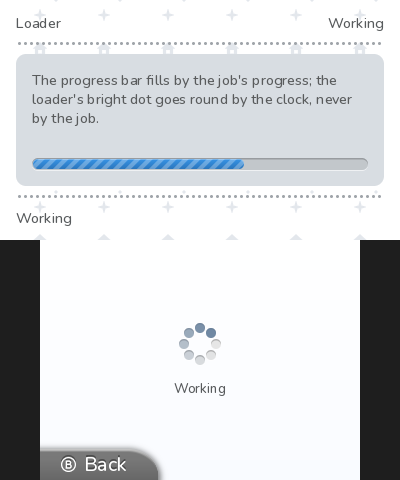
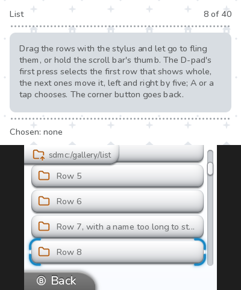
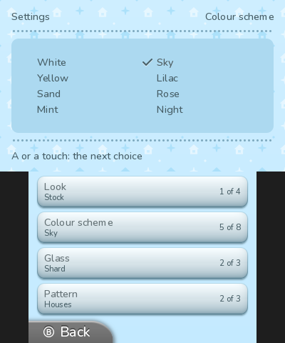

# Elements

Every element the drawing layer offers, in the order of [`ui.h`](../include/ui.h). Each entry gives what it is, its function with its arguments as the header declares it, what of it the look draws (the `look_draw` hook, see [looks.md](looks.md)), and one place where 3DStockTheme uses it. Where no hook is named, the drawing layer draws the element the same way in every look, from the look's images.

Coordinates are console pixels: the top screen is 400 by 240, the bottom screen 320 by 240 ([layout.md](layout.md)). A `rect` is `x, y, w, h`. A `state` is 0, `UI_DOWN` (held by the stylus), `UI_OFF` (greyed out), or both, and may add `UI_AMBER`: the light behind the symbol is amber where the look draws one (Nachtglas's crystals); the caller says so for a symbol of its own, the kit's symbols have their lights in the look. Colours are `0xRRGGBB` values read through `SC()`, or citro2d colours made with `UI_COLOR()`.

## The frame and the two screens

The drawing layer is started once and draws a frame at a time. With the 3D slider up, a frame's drawing runs twice, the second time for the right eye's top screen:

```c
ui_begin(e); do { ui_top(); ...; ui_bottom(); ...; } while (ui_next_eye()); ui_end();
```

- Start and end: makes the atlas's texture and lets the look make its own; returns -1 when the texture could not be made. Look: `load` on start, `unload` on end. Example: the start of the application.
  - `int ui_init(void);`
  - `void ui_exit(void);`
  - `void ui_part(const art_part *part);` (before `ui_init`: the application's own sprites and pictures, ids from `ART_ALL` on, as the art generator writes them for it into `part_art.h` and `part_art.c`, `ART_APP_PART`; [part.md](part.md))
- Frame: one frame on both screens. `entered` goes from 0 to 1 while a screen that was just opened grows and fades in. Example: the installing screen.
  - `void ui_begin(float entered);`
  - `int ui_next_eye(void);`
  - `u32 ui_frame(void);` (a number that changes once per frame, not per eye)
  - `void ui_end(void);`
- Screens: everything drawn after `ui_top` goes to the top screen, after `ui_bottom` to the bottom screen. Look: `ground` draws each screen's background. Example: the installing screen.
  - `void ui_top(void);`
  - `void ui_bottom(void);`
- Black: a black over everything the frame draws on both screens, from 0 (none) to 1 (whole). Example: the start of the application fades in from it.
  - `void ui_black(float amount);`
- Flat ground: a screen asks the look's ground to draw its own light on the screen's plane, without depth, in the next frame. Example: the installing screen's tile.
  - `void ui_ground_flat(void);`
- Hit test: whether a point lies in a `rect`. Example: a list's rows.
  - `int ui_hit(rect r, int x, int y);`
- Statistics: 1 once, the first time a frame came near a drawing limit or a draw failed; and the frames' peaks and counts as one log line. Example: every frame of the application.
  - `int ui_stats_alarm(void);`
  - `void ui_stats(char *out, size_t size);`
- The look's choices: the look, the colour scheme, the glass style and the pattern drawn from the next frame on ([looks.md](looks.md)). Look: the old look's `unload`, the new one's `load` and `refresh`. Example: the settings screen and the start.
  - `void ui_look(int look, int scheme, int glass, int pattern);`

## Text

All text is drawn in the console's system font. `px` is the size in pixels; `align` is `UI_LEFT`, `UI_CENTER` or `UI_RIGHT`.



- Baseline: the baseline of text of size `px` centred in a line box of height `lh` from `top`. Example: the "Installiert" screen.
  - `float ui_baseline(float top, float lh, int px);`
- Width: how wide a line is. Example: the way pill between folders (an application widget).
  - `float ui_text_width(const char *s, int px);`
- One line: at its left edge, centre or right edge. Example: the way pill.
  - `void ui_text(const char *s, float x, float baseline, int px, uint32_t color, int align);`
- One line that fits: no wider than `w`, cut with "..." at its end, or at its beginning with `from_end`. Example: the "Installiert" screen.
  - `void ui_text_fit(const char *s, float x, float baseline, float w, int px, uint32_t color, int align, int from_end);`
- A block: text wrapped at width `w`, made smaller down to `min_px` until it fits `max_lines` and `max_h`, the last line ending in "..." when it still does not fit; returns 1 when all of it fit. Then its height and its drawing. Example: the check screen of a file.
  - `int ui_wrap(ui_block *b, const char *s, float w, int px, int min_px, int max_lines, float max_h, float lh);`
  - `float ui_block_height(const ui_block *b);`
  - `void ui_block_draw(const ui_block *b, float x, float top, uint32_t color, int align);`

The wrapping itself is [`wrap.h`](../include/wrap.h) ([input.md](input.md)).

## Images and icons

Images are sprites of the atlas that the art generator draws at build time (`ART_*` ids in the generated `ui_art.h`).

- Sprite: at its own size, `x, y` its element's top left corner (a shadow may reach past it). Example: the QR code scanner's bottom screen.
  - `void ui_sprite(int id, float x, float y);`
- Stretched sprite: stretched to `r` along the axes it stretches on; and the part of it between `x = from` and `x = to`. Example: the installing screen's steps (an application widget); the part: Nachtglas's popup buttons.
  - `void ui_sprite_box(int id, rect r);`
  - `void ui_sprite_part(int id, rect r, float from, float to);`
- Theme icon: a theme's 48x48 SMDH icon with rounded corners, drawn `size` by `size`; eight per frame. It waits in the drawing order so that no text is laid over it ([looks.md](looks.md)). Example: a design's card on the top screen (an application widget).
  - `void ui_icon(const uint8_t *smdh_icon, float x, float y, float size);`
- Camera picture: a 400x240 RGB565 camera frame over the whole top screen; `NULL` draws its place in `COL_CAMERA` until the first frame. Example: the QR code scanner's top screen.
  - `void ui_camera(const uint16_t *frame);`
- Progress bar: with moving diagonal stripes; a `fraction` below 0 draws a striped piece sliding to and fro. Example: the card shown during a wait, reading a folder, checking a theme or downloading (an application widget).
  - `void ui_progress(rect r, float fraction);`
- Selection: the breathing corners round `r`, drawn after all of a screen's elements; with one radius, or one per corner (top left, top right, bottom left, bottom right). Look: `select`. Example: the cursor on every screen; the corners: Frost's popup buttons.
  - `void ui_select(rect r, int radius);`
  - `void ui_select_corners(rect r, const int radius[4]);`

## The top screen's parts



- Dotted line: the top screen's line at `y`. Look: `rule`. Example: a design's card (an application widget). Every look draws it rightly only as the line under a header (`y` at most `SCREEN_H / 2`, as `ui_head` at `HEAD_DOTS_Y`), over a footer (`y` below the middle, as `ui_foot`) or at the top of a screen without a header (`HERO_DOTS_Y`), drawn before anything else between it and the screen's nearer edge: Frost draws a glass strip over that whole band (none at `HERO_DOTS_Y`), so a line across the middle of the screen covers what stands above it.
  - `void ui_dots(float y);`
- Card: where the top screen's card stands. Example: a design's card.
  - `rect ui_card_rect(void);`
- Header: the header line of the screens other than the start, with the dotted line under it. Example: the folder view's top screen.
  - `void ui_head(const char *left, const char *right);`
- Footer: the dotted line and the footer line under it, a symbol (-1: none) and a left text cut at its end, or at its beginning when it is a path; then a warning in `COL_ALERT` at its right end. Example: the footer of the application's screens; the warning: the Designs menu's footer.
  - `void ui_foot(float dots_y, int symbol, const char *left, uint32_t left_color, int from_end, const char *right);`
  - `void ui_foot_warn(const char *right);`
- Plain card: a card of the look drawn, in the card's material, at any place (the top screen's card at `ui_card_rect`). Look: `card` without a glass style. Example: a design's card.
  - `void ui_card(rect r);`
- Glass card: a card with the calm glass edge of the chosen glass style. Look: `card` with the glass style. Example: the installing screen's two cards.
  - `void ui_card_glass(rect r);`
- Signs once on a pair of screens: the top screen notes the motif of every sign it draws in its card's head and footer (`ui_top_signs`); a note under it then shows its sign only when the top screen does not show it already. `ui_motif` gives a sprite's motif, `ui_sign_once` the sign to draw or -1. Example: a design's card; the popup's sign.
  - `static inline unsigned ui_motif(int sprite)`
  - `static inline int ui_sign_once(int sign)`

## The bottom screen's tiles

`kind` is a face: `FACE_TILE`, `FACE_CHOICE`, `FACE_ROW`, `FACE_FOLDER`, `FACE_GO`, `FACE_ALT`, `FACE_DTILE`, `FACE_WIDE` or `FACE_SET`, each with its own sprites for normal, held and greyed out. `symbol` is a sprite id; `ink` the label's colour.

A face stretches to its rectangle's width but is drawn at its own fixed height, whatever the rectangle's height says (`ui_layout.h`): `FACE_TILE` `TILE_H` (144), `FACE_CHOICE` `CHOICE_H` (110), `FACE_DTILE` `DTILE_H` (112), `FACE_GO` and `FACE_ALT` `GO_H` (84), `FACE_WIDE` `WIDE_H` (66), `FACE_ROW` `ROW_H` (50), `FACE_FOLDER` `FOLDER_H` (38); its shadow reaches `FACE_PAD_LOW` (7) below. Only `FACE_SET` grows with its rectangle's height (a row is at most `SET_H_MAX`, 44), so lay a page out to these heights, and use `FACE_SET` where a tile must be lower.

- Tile: the face, a symbol and a label under it, both centred. Look: `face`. Example: the start screen's tiles.
  - `void ui_tile(int kind, rect r, int state, int symbol, const char *label, int px, int lh, int gap, uint32_t ink);`
- Wide tile: the symbol left of a one-line label, centred in `r` as one group. Look: `face`. Example: the Designs menu.
  - `void ui_wide(int kind, rect r, int state, int symbol, const char *label, int px, int gap, uint32_t ink);`
- Stack: a symbol with a label wrapped under it (two lines at most), centred in `r`, without a face. Example: the installing screen.
  - `void ui_stack(rect r, int symbol, const char *label, int px, int lh, int gap, uint32_t ink);`
- Facts: what is known about a design as a short list in a box of the card's material, per row a symbol (a sprite's id: the kit's `ART_*` or one of the program's part, `ui_part`) and one line, up to `UI_FACTS` rows, centred on the bottom screen with its top at `y`. Look: `card`. Example: one installed design's screen.
  - `void ui_facts(const ui_fact *rows, int count, float y);`

## Buttons, bars and tabs

- Green button: an icon left of the label, for the main action. Look: `face`. Example: the choice to install with or without music.
  - `void ui_go(rect r, int state, int icon, const char *label);`
- Second button: the same in the tiles' cream. Look: `face`. Example: "Ohne Musik installieren" on the same screen.
  - `void ui_alt(rect r, int state, int icon, const char *label);`
- Bar with one action: a tab in the lower left corner (`key`: `UI_KEY_A`, `UI_KEY_B` or `UI_KEY_START`), a tab in the lower right corner, or the bar across the screen on the start screen. Look: `bar` and `bar_label`. Example: the Designs menu; the right tab: the "Installiert" screen; across: the start screen.
  - `void ui_bar(const char *key, const char *label, int down);`
  - `void ui_bar_right(const char *key, const char *label, int down);`
  - `void ui_bar_wide(const char *key, const char *label, int down);`
- Bar with two actions: a tab in each lower corner, B left and A right; `down` 0 the left held, 1 the right, -1 neither. Look: `bar` and `bar_label`. Example: the folder view.
  - `void ui_bar2(const char *left, const char *right, int down);`
- Bar with B and Y: the same with Y on the right, on the screens a preview starts from. Look: `bar` and `bar_label`. Example: a design's detail.
  - `void ui_bar_y(const char *left, const char *right, int down);`
- Where the bar takes touches: the box round the left tab, the wide bar's place, and whether a point is on a tab as drawn (not in the rounded corner beside it). Example: the wide bar and the tabs on every screen's touch handling. `ui_bar_rect` has no caller in 3DStockTheme.
  - `rect ui_bar_rect(void);`
  - `rect ui_bar_wide_rect(void);`
  - `int ui_tab_hit(int right, int x, int y);`
- Corner button: over the folder view's top left, one folder up, with the folder's path (cut at its beginning when it would grow past `CORNER_MAX_W`); its size follows the path. Look: the folder button's metrics (`corner_h`, `corner_icon_x`, `corner_icon_y`). Example: the folder view.
  - `void ui_corner(const char *path, int enabled, int down);`
  - `rect ui_corner_rect(const char *path);`
- Help button: round, at the top right, with its touch target and its lower edge as the look draws it. Look: the help button's metrics (`help_size`, `help_mark_y`, `help_mark_down`). Example: the "Installiert" screen.
  - `void ui_help(int down);`
  - `float ui_help_low(void);`
  - `rect ui_help_rect(void);`
- Settings button: the corner button's image at its smallest, at the top left, with the tool symbol and no text. Look: the settings tab's metrics (`tab_face`, `tab_face_down`, `tab_h`, `tab_icon_x`, `tab_icon_y`). Example: the start screen.
  - `void ui_settings_button(int down);`
  - `rect ui_settings_rect(void);`

## The popup

Built like the console's own dialog: the screen behind dimmed, a cream panel with the paragraphs centred, one button across its lower edge or two side by side (Cancel left, the action right). The text is laid out once, when the popup opens; drawing it then needs only how far it has opened.



- Layout: at `DLG_PX`, or smaller down to `DLG_MIN_PX`, until all paragraphs fit; `ui_popup_fit` takes a first paragraph with a path in it and cuts the path first. With a sign: leaves the sign's room above the text, and returns 0 when the text needs that room (the popup then goes without the sign). Each returns 1 when the text fits. Example: the help (`ui_popup_fit`), the question whether to create the folder `/Themes` (`ui_popup_text`), a note (`ui_popup_text_signed`).
  - `int ui_popup_fit(ui_popup *p, const char *first, const char *path, const char *const rest[], int count);`
  - `int ui_popup_text(ui_popup *p, const char *const paras[], int count);`
  - `int ui_popup_text_signed(ui_popup *p, const char *const paras[], int count);`
- Drawing: `left` `NULL` for one button; `held` and `ring` -1 none, 0 left, 1 right; `opened` 0 to 1 by the clock. Before the draw, its tone (1: the right button deletes) and its sign (-1: none) may be told. Look: `ground` for the dim, `popup_panel`, `popup_buttons`; the metrics `dim_pct` and `dlg_h`. Example: every popup of the application.
  - `void ui_popup_draw(const ui_popup *p, const char *left, const char *right, int held, int ring, float opened);`
  - `void ui_popup_tone(int removes);`
  - `void ui_popup_sign(int symbol);`
- Buttons' touch targets: with two, the left or the right half; with one, the whole button. Example: every popup.
  - `rect ui_popup_button(int two, int right);`

The touch guard and the keys of a popup are [`popup.h`](../include/popup.h) ([input.md](input.md)).

## The loader

Shown in the place of what the bottom screen shows while the application works. `cover` (0 to 1) takes the content back into the background; `shown` (0 to 1) brings a ring of dots whose bright one goes round by the clock, never by a job's progress, with one line under it and, only with that line, a notice under it. The caller moves both values by the clock. Look: `ground` and `loader`. Example: the preview's bottom screen.

- `void ui_loader(const char *line, const char *notice, float cover, float shown);`



## Rows

- Folder row: a folder's name on a row face. Look: `face`. Example: the folder view.
  - `void ui_row_folder(rect r, int state, const char *name);`
- Setting row: a setting's name, under it the choice that holds, and a note at the right end. Look: `face`. Example: the settings screen.
  - `void ui_row_setting(rect r, int state, const char *label, const char *value, const char *note);`
- Scroll bar: the track at `r`, the thumb covering `size` (0 to 1) of it from `at` (0 to 1); `held`: the stylus is on it. Example: the application's lists. The list's scrolling itself is [`scroll.h`](../include/scroll.h) ([input.md](input.md)).
  - `void ui_scrollbar(rect r, float at, float size, int held);`



## Choices

- Choices: the top screen's card as the list of a setting's choices, one line each from `name(0)` to `name(count - 1)`, the chosen one in ink with a check before it, the others muted. Look: `card`. Example: the settings screen's top.
  - `void ui_choices(int count, int chosen, const char *(*name)(int choice));`
- Choices at the top: the same list standing at the card's top, `CARD_PAD` below its edge (the distance the text keeps to the card's sides), for a program that puts lines of its own under it; in two columns when one would come closer than `CARD_PAD` to the card's lower edge. Returns the y under the last line, where the program's own lines may begin. Look: `card`. Example: none (the example puts nothing under a setting's choices; see its README).
  - `float ui_choices_top(int count, int chosen, const char *(*name)(int choice));`
- Backdrop: the chosen pattern behind the screen, so a change of pattern shows at once. Example: the settings screen's top.
  - `void ui_backdrop(void);`



## The information box

A problem's, a refusal's or an empty state's explanation on the bottom screen, in a box of the card's material, never bare on the ground. Text only (`head` is not drawn); text may break with `'\n'`; a path (`NULL`: none) stands in a line of its own under it, muted and cut at its beginning. `ui_info_height` gives the box's height in a room `room` px high (0: all the height above the bar); `ui_info_box` lays it out between `top` and `bottom` (0: the bar), centres it and returns its top. Look: `card`. Example: the folder view; the height: the QR code scanner.

- `float ui_info_height(const char *head, const char *text, const char *path, float room);`
- `float ui_info_box(const char *head, const char *text, const char *path, float top, float bottom);`

## The wide picture

A theme's wallpaper, as the preview shows it: tiled RGB565 texels as they lie in the theme's body, `width` (512 or 1024) by 256, copied into a texture that stays until the next one (returns -1 when there is no memory for it). Then that wallpaper over the whole screen being drawn from its texel `x` on, or a colour from `upper` at the top to `lower` at the bottom. Example: the preview.

- `int ui_wall_set(int bottom, const uint8_t *tiled, int width);`
- `void ui_wall(int bottom, float x);`
- `void ui_wall_color(const uint8_t upper[3], const uint8_t lower[3]);`

The camera picture (`ui_camera`) is under "Images and icons" above.

## The probes

Two builds for measuring, never delivered. Both are compiled only with their flag.

- Flicker probe (only in a build compiled with `UI_PROBE` defined): while armed, each frame copies the last frame's render target and framebuffer of the bottom screen and of the top screen's left eye, and takes their CRC-32s; `ui_probe` returns 1 when the last two frames were read. Example: the application's flicker probe.
  - `void ui_probe_arm(int on);`
  - `float ui_probe_slider(void);`
  - `int ui_probe(int top, ui_probe_frame *now, ui_probe_frame *before);`
- The comparison of two frames: a frame counts only once its screen has stood still for more than `PROBE_STILL` frames; returns which of the two changed. Example: the same.
  - `static inline int probe_compare(unsigned *run, probe_tally *t, int still, int read, uint32_t target_was, uint32_t target_is, uint32_t fb_was, uint32_t fb_is)` ([`probe.h`](../include/probe.h))
- Fit probe (`UI_PROBE` or `UI_FIT_PROBE`): a text laid out as the information box or a note would lay it out, nothing drawn; its size, its lines and whether a line was cut. Example: the application's fit probe at the start.
  - `void ui_info_probe(const char *head, const char *text, ui_fit *f);`
  - `void ui_note_probe(const char *head, const char *text, ui_fit *f);`
