# Starting with the kit

The kit is a C library for Nintendo 3DS homebrew that draws a program's two screens: buttons, bars, tiles, lists, popups, a loader and text that fits, in one of four looks and eight colour schemes, with interface sounds and menu music. It builds on citro2d, citro3d and libctru and does not replace them; a program still reads its own input and decides what each screen shows.

The kit's example, [`example/`](../example/README.md), is the place to start: a small gallery program built on the kit alone, a page for each group of elements. Everything on this page is taken from it.

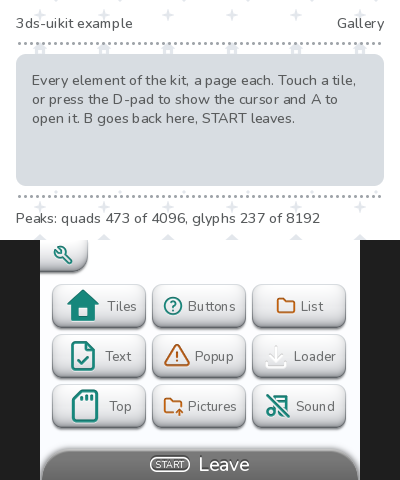

The pictures on these pages are still frames of the example, recorded on the Mac by the kit's host build and drawn by its own renderer (`tools/flows/raster.py`, run by `make docs-pictures`); their text is set in Nunito ([credits.md](credits.md#the-renderers-font-nunito)), not in the console's system font, so a label can be cut at another place than on the console.

## The smallest program

A program starts the kit with `ui_init`, draws every frame between `ui_begin` and `ui_end`, and ends it with `ui_exit`. This is the example's own start, end and loop, from [`example/main.c`](../example/main.c):

```c
static void start(void)
{
    osSetSpeedupEnable(true);   /* first, as the application: a New 3DS at its higher clock (libctru asks ptm:sysm) */
    audio_log = sound_log;      /* before audio_init: its line says whether there is sound */
    ui_init();
    audio_init();
    audio_menu(-1);             /* no music until the sound page asks for it */
    started_at = opened_at = frame_now = osGetTime();
}

static void finish(void)
{
    audio_exit();
    ui_exit();
}

int main(void)
{
    start();
    while (aptMainLoop() && frame())
        ;
    finish();
    return 0;
}
```

`ui_init` brings up the graphics itself (`gfxInitDefault`, `C3D_Init`, `C2D_Init` and `C2D_Prepare`) and `ui_exit` closes them (`C2D_Fini`, `C3D_Fini`, `gfxExit`), so a program on the kit calls none of these itself. `osSetSpeedupEnable` is libctru's: on a New 3DS it asks for the higher clock and its cache (it opens and closes `ptm:sysm` itself), on an old one it changes nothing.

A frame draws both screens. `ui_top` and `ui_bottom` each give their screen its background; whatever is drawn after one of them lands on that screen. With the 3D slider up the loop runs a second time for the right eye, so the drawing stays inside `do ... while (ui_next_eye())`, and what is drawn in it only draws: it changes no state and reads no clock, or the right eye sees another frame than the left one. The example reads the frame's time once at its input (`frame_now`, which the pages draw with) and counts and changes things in the input's step (a page's `own`, `press`), never in `top` or `bottom`:

```c
static void draw(u64 now)
{
    int held = touch_held(&touch, now);
    ui_begin(ease_span(now, opened_at, TRANSITION_MS));    /* the plain span: the kit eases it */
    ui_black(1 - ease_span(now, started_at, FADE_MS));
    do {
        ui_top();
        shown->top();
        ui_bottom();
        shown->bottom(held >= 0 && held < shown->count ? held : -1);
        int tab = held == T_LEFT ? 0 : held == T_RIGHT ? 1 : -1;
        if (shown->bar)
            shown->bar(tab);
        else if (shown == &page_start)
            ui_bar_wide(UI_KEY_START, "Leave", held == T_WIDE);
        else if (shown->right)
            ui_bar2("Back", shown->right, tab);
        else
            ui_bar(UI_KEY_B, "Back", tab == 0);
        if (cursor_shown && shown->count && shown->select)
            shown->select(cursor);
        else if (cursor_shown && shown->count)
            ui_select(shown->target(cursor), TILE_R);
    } while (ui_next_eye());
    ui_end();
}
```

`ui_begin` takes how far a screen that was just opened has come in, the plain span of time (0 to 1 over `TRANSITION_MS`, from `ui_layout.h`): the kit eases it itself, so a program does not; `ui_black` fades the whole frame from black at the start. The look, colour scheme, glass style and pattern are set with `ui_look` before a frame; until then they are Stock, the first scheme, `GLASS_SHARD` and `PATTERN_HOUSES`.

## The one rule that breaks silently

Text is never drawn directly after an image from a texture other than the kit's atlas. On the console, letters drawn right after such an image sometimes take stale texels for one frame and vanish; nothing fails on the Mac, so the mistake does not show until it flickers on the console.

For a program this means one thing: `ui_top` and `ui_bottom` draw the screen's background (the ground) from the look's own texture, so the first thing drawn on each screen after them is an image from the atlas, such as `ui_head`, `ui_card`, a tile or `ui_wide`, and never text. The example's text page sets its text on the bare ground and so draws its head line first, from [`example/page_text.c`](../example/page_text.c):

```c
    ui_ground_flat();           /* this screen sets its text on the ground's light without depth */
    ui_head("Text", narrow ? "Narrow" : "Wide");    /* an atlas image first: no text straight on the ground */
```

The kit keeps the rest of the rule itself: a theme's icon (`ui_icon`) and the other pictures of a texture of their own wait in an order list and are drawn only before an image that could cover them and when the screen is done, never right before text. A ground cannot wait, since everything else stands on it: that is why the next thing after it has to be a visible atlas image, and that part is the program's. The rule and its reason are in [`order.h`](../include/order.h) and [`kit.h`](../include/kit.h), and in [looks.md](looks.md#the-drawing-rule). The project checks it on recorded frames with `tools/flows/order.py`; the example's test runs it on the frames its walk captures, 123 still frames from every one of the 11 pages in every one of the 4 looks the build holds (the settings page switches the look as a user would), once with the 3D slider down and once with it up.

## Building the example for the 3DS

In the devkitPro image, from the kit's folder (`make example` there runs the same):

```sh
docker run --rm --network none --platform linux/amd64 -v "$PWD":/src -w /src/example devkitpro/devkitarm:20260610 make
```

The result is `example/build/3ds-uikit-example.3dsx`, for the Homebrew Launcher. Its [`Makefile`](../example/Makefile) shows everything a program on the kit needs to build:

- The kit's art, drawn at build time by the kit's generator: `python3 -I art/art.py --look <look> --part <folder>/<look>.part` for each look, then `python3 -I art/art.py --join <folder> <looks>`, which reads those parts (`<folder>/<look>.part` for each look named, `stock` first) and writes `ui_art.h`, `ui_art.c` and `art_<look>.c` into the same folder. Without `--app`: the example brings no images of its own.
- `looks_built.h`, two lines the Makefile writes: `LOOKS_HELD` and `LOOKS_BUILT(X)`, the looks this build holds. The Makefile takes every look whose `look_<name>.c` is in the kit's `source/`.
- The sounds, linked in as they are by `source/sound_data.S`, assembled with the kit's `include/` on the include path (it includes `tracks.h`) and its `sound/` folder on the assembler's.
- Every `.c` file of the kit (`source/`) beside the program's own, with the kit's `include/` on the include path, and `-lcitro2d -lcitro3d -lz -lctru -lm`.

The art generator and its hook for a program's own images are described in [part.md](part.md).

## Taking the kit

A program takes the kit one of two ways; both give the same program (the example built each way is the same bytes, `tools/build/installed.sh` shows it).

- As a git submodule pinned to one commit ([repository.md](repository.md#taking-the-kit) says how): the program's Makefile builds the kit as the example's does above, every `.c` of the kit, its art and its sounds beside its own files. 3DStockTheme takes it this way.
- As an installed library: in the devkitPro image, `make lib` in the kit's folder builds `build/3ds/lib3ds-uikit.a` (every `.c` of the kit, its art for every look and `sound_data.S`, with the example's flags), and `make install` copies it with the rest into `$(DESTDIR)$(prefix)`; `prefix` is devkitPro's 3DS portlibs folder, 3ds_rules' `PORTLIBS` (`/opt/devkitpro/portlibs/3ds` in the image), and `DESTDIR` (empty by default) puts it into a staging folder instead. The pacman package ([`pacman/PKGBUILD`](../pacman/PKGBUILD)) installs the same files: its `build` is `make lib`, its `package` is `make install DESTDIR="$pkgdir"`. The program then compiles its own files only, with `-I$(PORTLIBS)/include/3ds-uikit`, and links `-l3ds-uikit -lcitro2d -lcitro3d -lz -lctru -lm`; the example does that with `make UIKIT=$(PORTLIBS)` (or `UIKIT=` a staging folder's copy of the prefix), into `example/build/installed/`, and reads nothing of the kit's folder then.

What `make install` puts under the prefix, laid out as the 3DS port libraries of devkitPro's pacman lie (3ds-zlib's: `include/zlib.h`, `lib/libz.a`, `licenses/3ds-zlib/LICENSE`):

| Folder | What it holds |
| --- | --- |
| `lib/` | `lib3ds-uikit.a` |
| `include/3ds-uikit/` | every header of the kit (its `include/`), and the two its art generator writes, `ui_art.h` and `looks_built.h` (all four looks held) |
| `share/3ds-uikit/` | the art generator in the repository's own layout, since it finds what it reads from the folder above its own: `art/` (`art.py`, `schemes.py`, `liquid.py`, `look_<name>.py`), `include/` with the headers it reads (`ui_layout.h`, `popup_band.h`, `look_<name>.h`), and `icons/` with the icons' `LICENSE` |
| `licenses/3ds-uikit/` | the kit's `LICENSE`, `icons/LICENSE` and `sound/CREDITS.md` (the sounds are inside the library) |

The docs are not installed: they are read in the kit's repository, as the image's 3DS port packages leave theirs out (of its 50 `3ds-`, libctru and citro packages only `3ds-opusfile` installs anything of the kind, its `README.md`, `AUTHORS` and `COPYING` in `share/doc/opusfile/`). `prefix` and `DESTDIR` (when set) must be absolute paths without a space; `make install` stops with one line otherwise, before it builds anything.

The package's fields follow the 3DS port packages of the devkitPro image: the name with `3ds-`, `arch=('any')`, `groups=('3ds-portlibs')`, the licence spelt `zlib` as 3ds-zlib's, and `depends` on devkitPro's `libctru`, `citro2d`, `citro3d` and `3ds-zlib`. The image's makepkg cannot build the package file by itself: it has no `fakeroot` (makepkg's `package()` runs in it, and makepkg refuses root) and no `zstd` (makepkg.conf's `PKGEXT` is `.pkg.tar.zst`); `installed.sh` checks the description as far as the image allows (`makepkg --printsrcinfo`, its `build` and `package` run into a folder) and says what is missing.

A program with a part of its own (its images in the look's style, [part.md](part.md)) runs the generator from the installed kit, of the same version as the library: `python3 -I $(PORTLIBS)/share/3ds-uikit/art/art.py --app APP.py --look <look> --part <folder>/<look>.part` for each of the four looks (`stock`, `frost`, `night`, `prism`: the library holds all four), then `--app APP.py --join <folder> stock frost night prism`. It compiles only the part's files (`part_art.c`, `part_art_<look>.c`) with `<folder>` before the installed headers on its include path: the `ui_art.h`, `ui_art.c` and `art_<look>.c` the join writes beside them are the same bytes as the library's and are not compiled again.

## What the example shows

Each page is one file, `example/page_<name>.c`; the [example's README](../example/README.md) lists what each one shows.

- Start: a tile for each page and the settings button in the top left corner. Here is the start page in the other three looks, Frost, Nachtglas and Prisma:

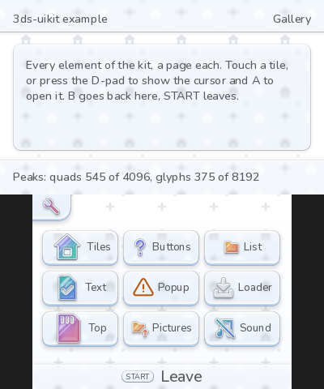 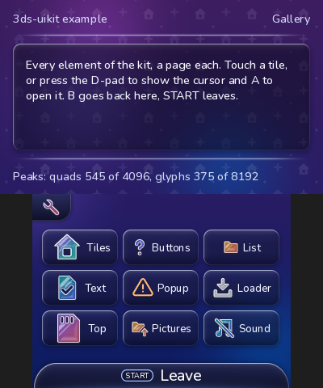 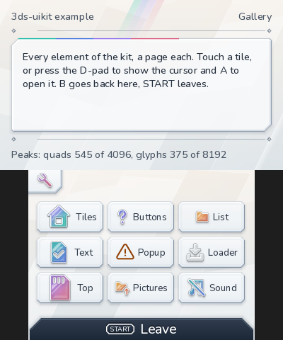

- Tiles: every kind of face, a tile plain and greyed out, and a stack without a face.
- Buttons: the green button and the second one side by side under the help button, and the bar in each of its kinds:

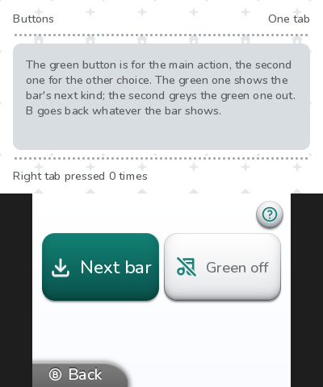
- List: forty rows that scroll by the D-pad, by dragging and flinging, and by the scroll bar's thumb, with the selection:

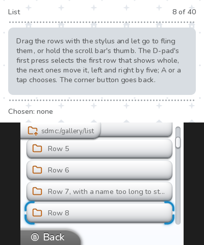

- Settings: the look, colour scheme, glass style and pattern, switched at once with `ui_look`; the setting's choices stand on the top screen (`ui_choices`):

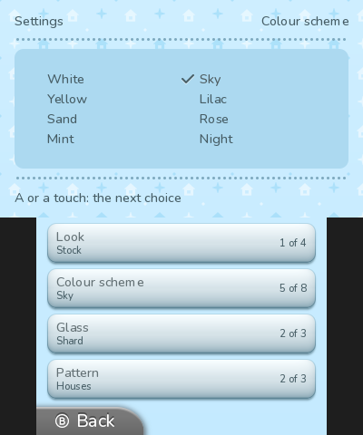

- Text: sizes, alignments, a measured width, lines cut at their end or their beginning, and a paragraph wrapped at two widths:

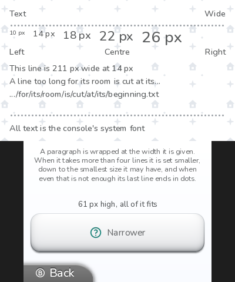

- Popup: plain, with a path, with the warning sign, and one whose right button deletes:

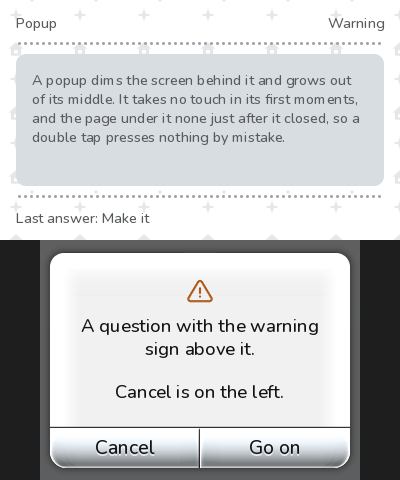

- Loader: a pretended job, the progress bar on the top screen and the loader on the bottom screen:

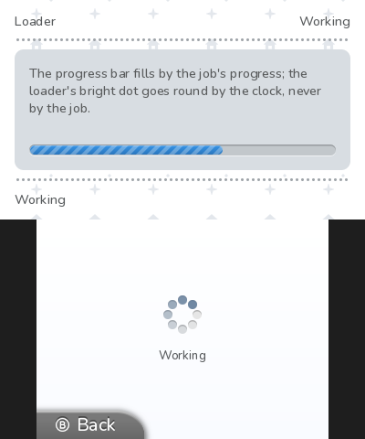

- Top: the top screen's parts (the header with its dotted line, or on a screen without a header the line alone, a plain or a glass card, three kinds of footer), and on the bottom screen a box of facts and the information box; the right tab switches the card and the footer:

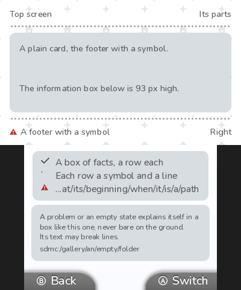

- Pictures and Sound: pictures a program makes from its own pixels, and every sound, the music and a theme's music (a track linked in, played with `audio_theme_play`).

## What a program brings itself

The kit draws; the rest is the program's. The example shows each of these:

- Its text and names. The kit holds no text of its own: every label, line and popup is the program's. The colour schemes, glass styles and patterns have only numbers (`ART_SCHEME_*` in the generated `ui_art.h`, `GLASS_*`, `PATTERN_*` in `ui.h`), so the example names them itself in `SCHEMES`, `GLASSES` and `PATTERNS` in [`example/page_settings.c`](../example/page_settings.c).
- Its layout numbers. The kit's own sizes, places and times are in `ui_layout.h` ([layout.md](layout.md)); where the targets of a screen stand, how wide their gaps are and the size of their labels is the program's: `PAD`, `GAP`, `LABEL_PX` and the others in [`example/gallery.h`](../example/gallery.h), and the list's rows in `page_list.c`, which hands them to `scroll.h` as a `scroll_shape`.
- Its input rules. `touch.h` is only the state machine of one touch (`touch_down`, `touch_move`, `touch_up`, `touch_held`): what a touch presses, that the first D-pad press only shows the cursor, that B goes back and START leaves, are the program's. The example writes them in `target_at`, `act`, `keys` and `take` in [`example/main.c`](../example/main.c), about a hundred lines ([input.md](input.md)).
- Its sound's log. `audio_log` takes the sound's log lines and is set before `audio_init`; `audio_ready` says afterwards whether sound can play (without the DSP firmware on the card it cannot) ([sound.md](sound.md)).
- Its own images, only when it has any. A program with pictures of its own in the look's style hands them to the art generator with `--app` and registers the result with `ui_part` before `ui_init` ([part.md](part.md)). The example has none and never calls `ui_part`; the kit runs without a part.
