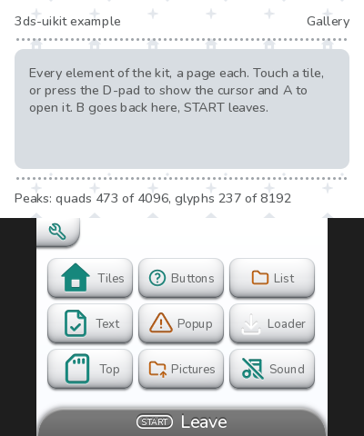
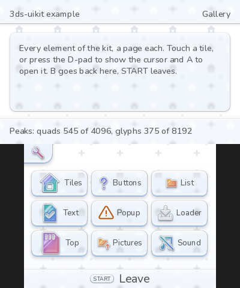
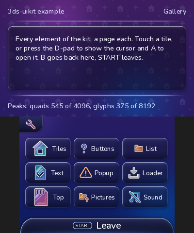
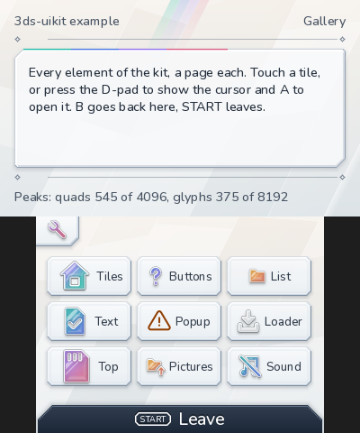

# Looks

A look is how the screens are drawn in one design. The drawing layer lays out every screen once and calls the look's table where the looks differ. A look draws only with [`ui.h`](../include/ui.h) and [`kit.h`](../include/kit.h). Stock is the fallback.

## The four looks

| Number | Name in the settings | File | What it is |
| --- | --- | --- | --- |
| `LOOK_STOCK` | `stock` | [`look_stock.c`](../source/look_stock.c) | the look of the console's own menus, rebuilt from measurements; every build holds it |
| `LOOK_FROST` | `frost` | [`look_frost.c`](../source/look_frost.c), [`look_frost.h`](../include/look_frost.h) | frosted glass over the colour schemes |
| `LOOK_NIGHT` | `night` | [`look_night.c`](../source/look_night.c), [`look_night.h`](../include/look_night.h) | Nachtglas, a dark look of smoked glass |
| `LOOK_PRISM` | `prism` | [`look_prism.c`](../source/look_prism.c), [`look_prism.h`](../include/look_prism.h) | Prisma, light and angular glass with cut corners |

A look's own header holds only its numbers (`#define`s); the look's generator reads them too.

The kit's example's start page in each look, Stock, Frost, Nachtglas and Prisma, in the same colour scheme ([example.md](example.md); drawn by the host renderer, the text in Nunito, not the console's font):

   

- The look of a number when this build holds it, else Stock; and whether the build holds it:
  - `const look *look_get(int id);`
  - `int look_built(int id);`

## Colour schemes, glass styles and patterns

`ui_look(look, scheme, glass, pattern)` ([elements.md](elements.md)) sets all four for the frames that follow. At first they are Stock, the standard scheme, `GLASS_SHARD` and `PATTERN_HOUSES`.

- Colour scheme: `ART_SCHEME_*` from the generated `ui_art.h`, the standard first. The schemes are made by the art generator's [`schemes.py`](../art/schemes.py) from the colours of [`ui_layout.h`](../include/ui_layout.h); 3DStockTheme's settings know eight: white, yellow, sand, mint, sky, lilac, rose and night. A colour that follows the scheme is read as `SC(COL_NAME)`; changing the scheme unpacks its atlas at the next `ui_begin`, so a frame never mixes two schemes.
- Glass style, for every glass element (the house, the tiles' symbols, the picture's badges): `GLASS_CLEAR` (white glass), `GLASS_SHARD` (coloured glass), `GLASS_PLATIN` (two bright tones that meet at a horizon). A glass element's images stand in the atlas in this order: `ART_<element> + style`.
- Pattern that drifts behind the start screen and the settings: `PATTERN_PLUS`, `PATTERN_HOUSES`, `PATTERN_BUBBLES`. How it drifts: `turn_drift` in [input.md](input.md).

## The look table

`look.h` defines `struct look`: `name`, `art`, `draw` and `m`.

`draw` (`look_draw`) holds functions only, and a look gives every one:

| Hook | What it draws | Called by |
| --- | --- | --- |
| `load`, `unload` | the look's own textures, made when it is chosen and freed | `ui_init`, `ui_exit`, a change of look |
| `refresh(scheme, pattern)` | after the atlas (pattern -1) or the pattern's tile changed | a change of scheme or pattern |
| `ground(y0, y1, alpha)` | the screen drawn now from `y0` to `y1`, a moving background too | `ui_top`, `ui_bottom`, the popup's dim, the loader |
| `rule(y)` | the top screen's line | `ui_dots` |
| `card(r, glass)` | the card (glass -1), or the glass card in a style | `ui_card`, `ui_card_glass`, `ui_facts`, `ui_choices`, `ui_choices_top`, `ui_info_box` |
| `face(kind, r, state, symbol)` | a face of a kind (`state` with `UI_AMBER`: the light behind its symbol amber, where the look draws one); returns where the content goes | `ui_tile`, `ui_wide`, `ui_go`, `ui_alt`, `ui_row_folder`, `ui_row_setting` |
| `select(r, radius)` | the selection | `ui_select`, `ui_select_corners` |
| `bar(parts, held)` | the bar's tabs (`BAR_LEFT`, `BAR_RIGHT`) or the whole bar (`BAR_WIDE`) | `ui_bar`, `ui_bar_right`, `ui_bar_wide`, `ui_bar2`, `ui_bar_y` |
| `bar_label` | the bar's labels (Stock and Prisma: `ui_engraved`) | the same |
| `popup_panel(r)`, `popup_buttons` | the popup's panel and its buttons | `ui_popup_draw` |
| `loader(cx, cy, ms, alpha)` | the ring shown while the application works, in `LOADER_BOX` round its middle | `ui_loader` |

`m` (`look_metrics`) holds shorts only, none 0 but the last two: the popup's dim (`dim_pct`) and panel height (`dlg_h`); the settings tab (`tab_face`, `tab_face_down`, `tab_h`, `tab_icon_x`, `tab_icon_y`); the folder button (`corner_h`, `corner_icon_x`, `corner_icon_y`); the help button (`help_size`, `help_mark_y`, `help_mark_down`); the carousel's panes (`pane_rim_big`, `pane_rim_small`, `pane_apart`); and `ground_sun` (the look's ground draws a light of its own on every top screen).

## How a look is written

A look is one file, `source/look_<name>.c` (with an optional `include/look_<name>.h` for its own numbers), that defines one `const look`. Its art is drawn at build time by a generator, `art/look_<name>.py`, into `art_<name>.c`. A look draws only with `ui.h` and `kit.h`; it may copy from `look_stock.c` and may not call another look's file. The table in `look.h` has four parts:

- `name`: the look's name in the settings, for example `"stock"`.
- `art`: the look's images (`look_art`, declared in the generated `ui_art.h`).
- `draw` (`look_draw`): functions only, every one given: `load`, `unload`, `refresh`, `ground`, `rule`, `card`, `face`, `select`, `bar`, `bar_label`, `popup_panel`, `popup_buttons`, `loader`.
- `m` (`look_metrics`): shorts such as the popup's dim and height, the tabs' faces and icon places, the help button, the carousel's pane rims.

Stock's table, shortened:

```c
const look look_stock = {
    .name = "stock",
    .art = &ART_STOCK,
    .draw = { .load = none, .unload = none, .refresh = refresh, .ground = ground, .rule = rule, .card = card,
              .face = face, .select = brackets, .bar = bar, .bar_label = ui_engraved, .popup_panel = popup_panel,
              .popup_buttons = popup_buttons, .loader = loader },
    .m = { .dim_pct = DIM_ALPHA, .dlg_h = DLG_H, .tab_face = ART_CORNER, /* ... */ .pane_apart = SWARM_STOCK_APART },
};
```

A look registers by its file being there: the build writes `looks_built.h` with every `source/look_<name>.c` present, Stock always, and `look.c` lists them. A new look also needs at least its number in `look.h`'s enum and its `extern` line there.

## The drawing rule

On the console, letters drawn directly after the texture of the themes' icons sometimes took stale texels for one frame. So a picture is not drawn when it is asked for: it waits, and the waiting pictures are drawn in their order only before an image that could cover one of them and when the screen is done. Text never draws them, so text is never laid over a picture. [`order.h`](../include/order.h) holds the rule in one place:

- `static inline void order_flush(order *o)`: the waiting pictures are drawn.
- `static inline int order_picture(order *o, order_rect r)`: a picture is asked for at `r` and waits.
- `static inline void order_image(order *o, order_rect r, float reach)`: an image is about to be drawn on `r`; if it could cover a waiting picture, all of them are drawn first.

For a look this means: its own texture is drawn either as a piece (`ui_piece`), which waits, or as a ground (`ui_ground_image`), drawn at once under everything; after a ground, the next thing drawn before any letters is a visible atlas image, never text.

## What `kit.h` gives a look

The frame's state `ui_f` (`struct ui_frame`: its time, the grounds' clock, its number, the 3D slider, how solid images are drawn, the view's shift, the eye, the screen, the scheme, the pattern, the look, `ground_flat`), read by looks and written by the drawing layer alone. And:

| Group | Functions |
| --- | --- |
| Images | `ui_sprite_info` (a sprite's entry), `ui_sprite_tex` (its texture), `ui_ew` and `ui_eh` (an image's element size, without its shadow), `ui_sprite_draw` (over `r`, cut to columns, tinted), `ui_sprite_tinted`, `ui_sprite_scaled`, `ui_sprite_turned` (turned about its middle), `ui_unpack` (a zlib blob into a texture) |
| Order | `ui_piece` (part of a texture, waiting unless it is the atlas), `ui_ground_image` (a ground at once), `ui_rect` (a rectangle in four colours), `ui_under` (the waiting pieces an image could cover), `ui_flush` (all of them) |
| View | `ui_layer` (the top screen's depth), `ui_view` (scaled and moved), `ui_edge_begin` and `ui_edge_end` (what stands on the screen's edge, neither zoomed nor faded), `ui_mix` (two colours mixed, with alpha) |
| Pieces | `ui_pattern` (the pattern's tile drifting from `y0` to `y1`), `ui_pattern_over` (a texture where the pattern shows), `ui_engraved` (engraved text, as the System Settings' bar), `ui_face_plain` (a face from the look's sprites), `ui_select_brackets` (the selection's corners) |

Their arguments are in [`kit.h`](../include/kit.h), each with its comment.

## What `widget.h` gives an application's own widget

A widget drawn outside the drawing layer (3DStockTheme draws its own so) may use, besides `ui.h` and `kit.h`, the state and helpers [`widget.h`](../include/widget.h) shares under the `ui_` prefix: the look drawn (`ui_lk`), the glass style (`ui_glass_want`), the transition's scale (`ui_zoom`), a scratch block for wrapped text (`ui_scratch`), the colour macros `INK`, `MUTED`, `TILE_INK`, `PRESS_INK`, and `MOVING_MS` (the clocks stand still in the probe build). Its functions:

- `static inline float ui_scale_of(int px)`: the font's scale for a size.
- `static inline unsigned ui_morton(unsigned x, unsigned y)`: a pixel's place in an 8x8 tile of the GPU's order (the order of the tiled pixels `ui_wall_set` and `ui_icon` take).
- `void ui_picture(C3D_Tex *tex, const Tex3DS_SubTexture *sub, const C2D_DrawParams *params, const C2D_ImageTint *tint, order_rect at);`: a picture, drawn when the drawing rule says.
- `void ui_icon_put(const uint8_t *smdh_icon, int slot, order_rect at, const C2D_ImageTint *tint);`: a theme icon into its slot of the icons' texture.
- `const char *ui_plain(char *out, const char *s, size_t n);`: the first `n` bytes, each control character as a space.
- `void ui_inline_symbol(int id, float x, float baseline);`: a symbol standing in a line of text.
- `void ui_start_textures(void);`: the part's pictures and the pattern's tile for the current choice.
- `C3D_Tex *ui_part_pictures(void);`: the application's part's pictures in the scheme wanted, unpacked when they are not the ones in their texture; `NULL` where the part brings none or they did not unpack.
